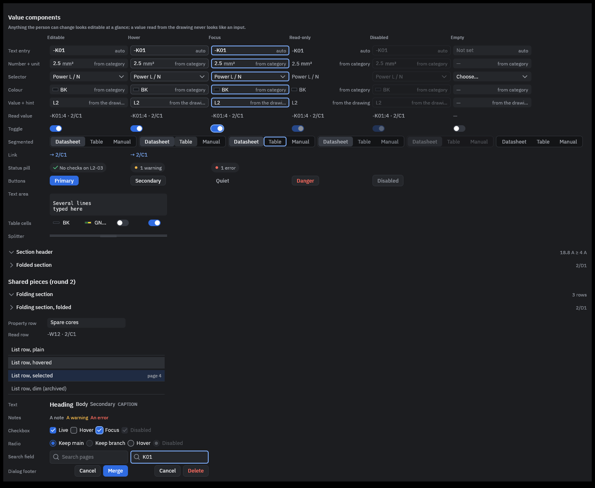
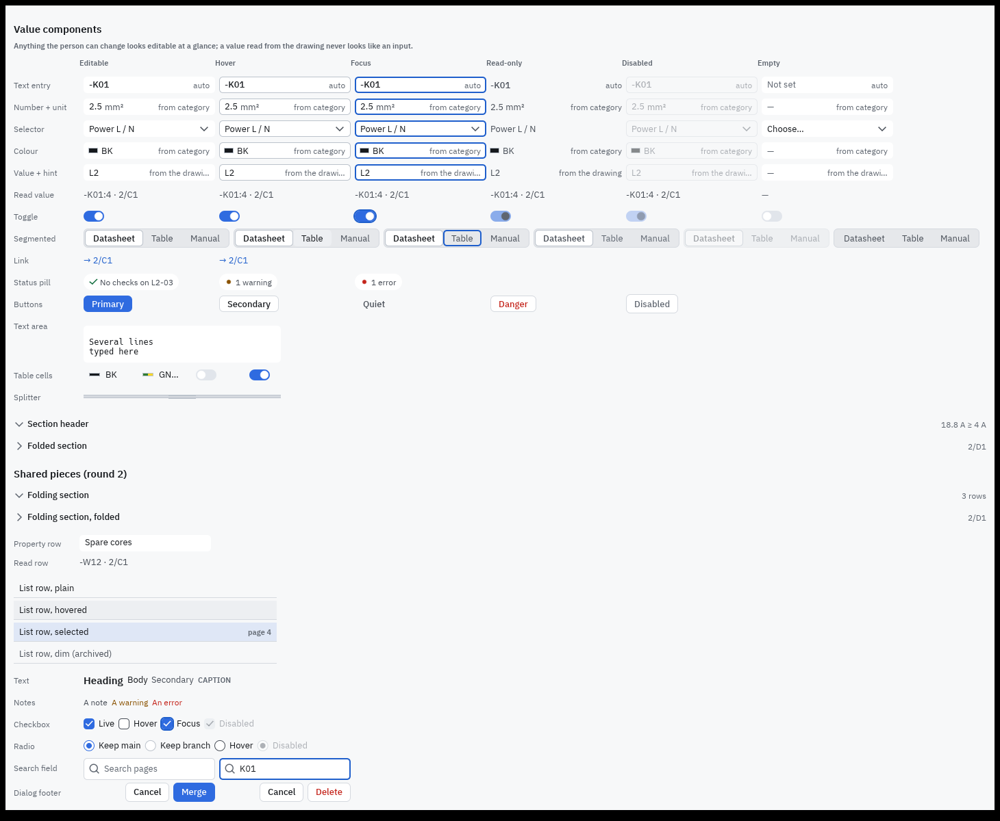

# UI components: the style guide for values in panels and dialogs

One component per kind of control, all in `ecad_widgets` and all drawn from its tokens (`ecad_widgets::tokens`;
the values are in [`../reference/tokens.md`](../reference/tokens.md)). Panels and dialogs use these and nothing
hand-rolled. `cargo xtask layers` fails on a new raw `egui::TextEdit` or `ComboBox` in an ECAD UI crate; the
files that still have one are listed in `RAW_CONTROL_FILES` (no counts) until they are converted
([`guards.md`](guards.md#ui-style)).

## The rule

**Anything the person can change looks editable at a glance:** a filled, rounded box that answers the pointer
(hairline on hover, focus ring when focused). **A value read from the drawing never looks like an input:**
plain grey text, no box. The contrast between the two is the point. Never show a bare dash where the person can
set a value: an empty editable value still has its box, with a placeholder or the dash inside it.

## The gallery

`ecad_widgets::showcase::components` draws every component in every state. The app shows it on the hidden
developer page `ui.primitives`, from the Text panel's Commands tab (Ctrl+/). The test
`shell::ui_primitives::the_component_gallery_shows_every_component_in_both_themes` (in `ecad-app`) checks it in
both themes and writes `components-dark.png` and `components-light.png` to `$ECAD_TESTER_SHOTS` when that names a
folder. The copies here come from that test.

Columns: **Editable**, **Hover**, **Focus**, **Read-only** (the value as read from the drawing), **Disabled**
(inside `ui.add_enabled_ui(false, …)`: kept in place, dimmed, no pointer), **Empty**.

## The components

Every box is `size.control_small` high, centred in a `size.control` row, after a label column of
`size.label_column`, so rows of mixed components line up. `control::row(ui, label, |ui| …)` lays out one row;
`panel::value_row` does it for a value with its kind.

| Component | For | Use it rather than another when | API |
| --- | --- | --- | --- |
| Text entry | Free text typed here: a tag, a description | The value is typed and has no fixed list | `control::TextEntry` |
| Number with unit | A number typed here, with its unit: `2.5 mm²`, `12 m`, `4 A`, `24 V`, `40 °C` | The value is a quantity. The unit is drawn after the number and never typed. Anything that isn't a number shows as invalid | `TextEntry::number(unit)` |
| Selector | One of a list longer than about five, or of names: a wire type, a cable type | The choices don't fit side by side, or come from a catalogue | `control::Select` (box and chevron, opens the list) |
| Segmented choice | One of two to six short choices, all visible: basis, scope, a text size | Every choice should be seen at once | `prim::Segmented` |
| Toggle | On or off, applied at once: label shown, bold, sample, snap | The setting is a yes or no that takes effect without a Save | `control::Toggle` |
| Colour | A wire or core colour: a swatch before the code (`▬ BK`) | The value is a colour code | `ValueBox`, `TextEntry` or `Select` with the `Decor` swatch |
| Value with hint | A value set on this object but edited elsewhere (the table, the page, a dialog), with where it comes from: `auto`, `from the drawing`, `from category` (a wire's value from its wire type), `set by hand` | The panel shows it but its editor is elsewhere. It still looks editable and takes a click | `control::ValueBox` (the `Decor` hint) |
| Read value | A value read from the drawing: from, to, cores used | The person can't change it here or anywhere but its page | `control::read_text`, or `prim::read_value` when it goes to its page |
| Link value | A go-to that names its target: `→ 2/C1` | The value is somewhere to go | `control::link` |
| Status pill | One line of status: `✓ No checks on L2-03`, `1 warning` | The status of the object shown, in its tone | `panel::status_pill` |
| Section header | A folding section: chevron, title, right-aligned summary (`18.8 A ≥ 4 A`) | A group of rows in a panel | `panel::section_header` |
| Buttons | Primary (one per view), secondary, quiet, danger; small in panels | An action, not a value | `prim::Button` |
| Dialog | A popup that asks for something: a table to edit, a choice to confirm. Opaque `panel` box with the shadow over the dimmed page; title and close cross; the footer's buttons right-aligned, tight to the bottom edge. Esc and the cross close it; a click on the page does not | Something must be answered before going on | `dialog::Dialog` |

### Table and layout pieces

| Component | For | API |
| --- | --- | --- |
| Text area | Several lines typed here (a rating table's CSV rows): the entry box, taller, in the code font | `control::TextArea` |
| Splitter | Resizing two stacked regions: a clearly defined double line across the width (a filled band between two lines) with a grip, a resize cursor and a hover highlight | `ecad_widgets::splitter::horizontal(ui, name)` |
| Colour cell | A colour in a table cell: the colour bar, then the code | `ecad_widgets::table` `Cell::Colour(bars, code)` |
| Toggle cell | On or off in a table row (a core's Not used): `control::Toggle` in the cell; a click reports `TableEvent::Button` | `ecad_widgets::table` `Cell::Toggle(on)` |

A colour shown as a panel value uses the `Decor` swatch; one in a table uses `Cell::Colour`. Both show a bar
before the code. All four are in the gallery.

### Lists, text and dialog pieces

| Component | For | API |
| --- | --- | --- |
| Folding section | A section header that keeps its fold state, with a summary or a quiet action at the right (`New branch`) | `prim::SectionHeader` |
| Property rows | A label in the label column and its value; a grid of them with no gap | `prim::property_row`, `prim::PropertyGrid` |
| List row | A selectable row of a list: text, a trailing count or page, dim when archived | `prim::ListRow` |
| Text styles | A dialog's heading, body text, a section's caption, a short note in a status tone (an error under a field) | `prim::heading`, `prim::body`, `prim::caption`, `prim::note` |
| Checkbox | A yes or no confirmed with the dialog's button (a setting applied at once is a Toggle) | `prim::Checkbox` |
| Radio | One of a few choices that each need words (for short choices, Segmented) | `prim::Radio` |
| Search field | The search box with its lens | `prim::SearchField` |
| Dialog footer | A dialog's buttons: one primary (or danger when it deletes), Cancel secondary | `dialog::action`; widths `Dialog::small` / `medium` (`size.dialog_s`, `size.dialog_m`) |

Ink on the accent is `shell.on_accent`; the `AI` chip's letters are `shell.ai_ink`. There is one error red
(`shell.error`) and one warning colour (`shell.warning`).

### Details that make a value read right

- **Key identity value** (a wire's number, a device's tag, a cable's tag): bold (`Decor` `bold`).
- **Choice fields** (wire type, cable type): the box carries a chevron (`ValueBox::chevron`, `Select`).
- **Units on values:** `2.5 mm²`, not `2.5`; lengths in `m` (`Decor` `unit`, `control::with_unit`).
- **Hints:** right-aligned in `text_3`, and only where the panel knows where the value comes from.
- **Provisional values:** `prim::provisional`, everywhere.

## Reviewing a panel or dialog

- Every value the person can change is a `TextEntry`, `TextArea`, `Select`, `Segmented`, `Toggle` or `ValueBox`
  (in a table: an input cell or `Cell::Toggle`), never a bare `ui.label`.
- Every read value is `read_text` or `read_value`, never boxed.
- No raw `egui::TextEdit`, `ComboBox` or hand-drawn switch. `cargo xtask layers` checks the first two.
- Light and dark both checked: the gallery test, or the panel's own screenshot test.
- A component that is missing is added to `ecad_widgets` and to `showcase::components`, not drawn in the panel.
